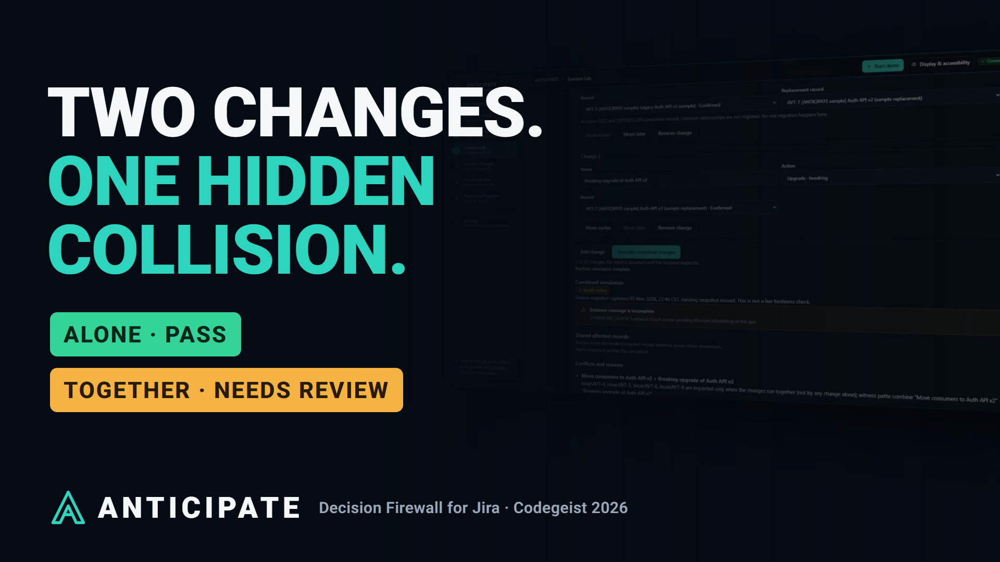
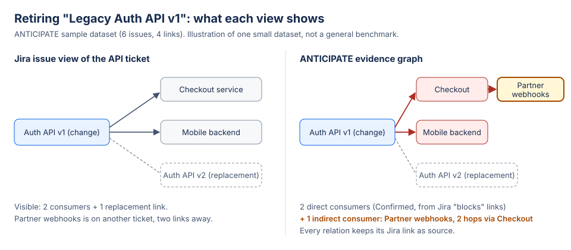

# ANTICIPATE — The Decision Firewall for Software Teams

[](https://github.com/toskaman/anticipate-codegeist-2026/actions/workflows/ci.yml)
[](https://codegeist2026.devpost.com/)
[](docs/evidence/MCP_EXTERNAL_RUNBOOK.md)
[](https://developer.atlassian.com/platform/forge/)
[](docs/submission/INSTALL_LINK.md)
[](LICENSE)

**Test the consequences. Prove the safeguards. Then ship.**



A Forge app for Jira that checks a risky change *before* it ships: it shows what really depends on it, compares safer options, refuses stale decisions and keeps a verified record of who decided what.

A ticket says "retire Auth API v1". It looks safe. The service that breaks is two links away, on an issue nobody opened, and the team finds out in production. Afterwards nobody can show what was known when the decision was made. ANTICIPATE exists so that story stops happening.

## For judges (2 minutes)

1. **Install** with the link in [docs/submission/INSTALL_LINK.md](docs/submission/INSTALL_LINK.md), then open **Jira → Apps → ANTICIPATE**.
2. **Start the guided demo** → Preview sample data → confirm → **Analyze** → Compare → Check safeguards → approve → execute → **Prevention Passport**.
3. **Verify the claims**: every behaviour below links to its evidence in the [evidence pack](docs/evidence/EVIDENCE_PACK.md); hosted results are labelled with date and site.

Demo video: public YouTube link will be added here on publication ([issue #189](https://github.com/toskaman/anticipate-codegeist-2026/issues/189)); the [script](docs/submission/VIDEO_SCRIPT.md) and [QA report](docs/evidence/VIDEO_QA_REPORT.md) are already in the repo.

## For engineering leaders

- **Know what will break** before the release train leaves: hidden multi-change collisions surface with names, paths and evidence — not hunches.
- **Ship calmer releases**: release readiness joins every change with its recorded decision (Blocked, Needs review, Verified…), and the Jira workflow gate enforces it at transition time.
- **Prove every decision** afterwards: each Prevention Passport records what was known, what was compared, who approved what, and what was verified by reading Jira back.
- **Procurement-friendly**: runs 100% on Atlassian Forge inside your Jira (no external egress), acts with each viewer's own Jira permissions, minimal scopes ([privacy](docs/legal/PRIVACY.md) · [terms](docs/legal/TERMS.md) · [threat model](docs/security/THREAT_MODEL.md)).
- **Honest about limits**: [no Teamwork Graph yet, no Marketplace listing, Jira-only evidence](#honest-limitations). What the app cannot know, it says.

Product context: [buyer hypotheses](docs/strategy/BUYER_HYPOTHESES.md) · [value-study protocol](docs/strategy/VALUE_STUDY_PROTOCOL.md) · [commercial strategy](docs/strategy/COMMERCIAL_STRATEGY.md). Licensing or pilot enquiries: info@lepcpro.fr.

## What it does

- **Evidence graph from real Jira links.** Every relation is Confirmed, Inferred or Unknown and keeps its Jira source; indirect consumers are shown with the path that reaches them. Unreadable evidence stays Unknown, never "safe".
- **Compare decisions on the same evidence.** Remove now, retain temporarily or migrate consumers first (or, for upgrades: breaking, backward-compatible shim, move consumers first). Deterministic and reproducible, with policy verdicts and the reason chain. "Migrate first" is labelled as an assumption.
- **Can this release proceed?** Release Safety (Mission Control) checks every change issue in a project or fixVersion against your recorded decisions: Blocked, Evidence incomplete, Needs review, Execution partial, Approved not executed, or Verified for the recorded scope. It also flags changes that touch the same Jira issue, and lists what it cannot know. Read-only. See [docs/product/RELEASE_SAFETY.md](docs/product/RELEASE_SAFETY.md).
- **Why is it blocked now?** Decision Time Machine (Prevention Passport) replays the recorded evidence checks of a decision. It shows when the evidence changed, the exact Jira relation added or removed, and why the approval can no longer authorize execution. Recorded history only; read-only. See [docs/product/DECISION_TIME_MACHINE.md](docs/product/DECISION_TIME_MACHINE.md).
- **What could we do instead?** Safe Change Composer (Scenario Lab, after a portfolio run) proposes up to 8 bounded alternatives: retain the old component, a compatibility phase for a breaking upgrade, or separate phases. Each is re-simulated by the same engine and ranked on blockers, conflicts, unknowns and impact, with its assumptions stated. Proposals only. See [docs/product/SAFE_CHANGE_COMPOSER.md](docs/product/SAFE_CHANGE_COMPOSER.md).
- **What if it slips?** A Scenario Lab panel delays an issue by 1–365 days and shows which due dates move, which releases become late, and what cannot be assessed, from live Jira due dates, links and fix versions. Also available as the `anticipate-simulate-slip` Rovo/MCP action. Simulation only: nothing changes in Jira.
- **Human approval, verified writes.** A prevention plan lists concrete Jira actions; a person approves, then confirms execution separately; every result is verified by reading Jira back. If the evidence changed after approval, execution is refused with zero writes.
- **Jira gate.** An optional workflow validator stops issues labelled `anticipate-change` until their decision is completed and live Jira links agree; an assumed migration does not open it. Admins choose what happens during an outage (allow by default, or block): see the [validator admin guide](docs/admin/WORKFLOW_VALIDATOR.md).
- **Prevention Passport.** An audit-style record that opens with a short answer (option, verified actions, transition status, open questions), then evidence, alternatives, approvals and timeline; JSON export and A4 print. Not a legal or cryptographic certificate.



## Install for judges

1. You need a Jira Cloud site with **Jira software projects** (a free site works) and a **company-managed software project** you can edit. Sites with only Jira Service Management cannot host the demo.
2. Install with the link in [docs/submission/INSTALL_LINK.md](docs/submission/INSTALL_LINK.md), then open **Jira → Apps → ANTICIPATE**. The first open takes about 10 seconds while Forge starts.
3. **Start the guided demo** → choose your project → **Preview sample data** (read-only) → confirm. Six labelled issues and four links are created (about 15–20 s the first time; nothing is created twice).
4. **Analyze** the sample root → **Compare options** (try **What if it slips?**) → **Check safeguards** → generate the plan → approve → execute → **Prevention Passport**.

Optional: the workflow validator and the MCP tools need an administrator; steps are in [INSTALL_LINK.md](docs/submission/INSTALL_LINK.md).

## Screens

Playwright captures of the real UI with a **mock backend transport (MOCK_TRANSPORT)**, labelled on screen. They are not hosted Jira results; those are in the [evidence pack](docs/evidence/EVIDENCE_PACK.md).

| Evidence Graph | Scenario Lab | Prevention Passport |
| --- | --- | --- |
|  |  |  |

## Documentation

| Start here | Evidence | Product & strategy |
| --- | --- | --- |
| [Install link](docs/submission/INSTALL_LINK.md) | [Evidence pack](docs/evidence/EVIDENCE_PACK.md) | [Release record](docs/RELEASE.md) (versions, test counts) |
| [Submission text](docs/submission/DEVPOST_FINAL.md) | [Video QA report](docs/evidence/VIDEO_QA_REPORT.md) | [Status](docs/STATUS.md) (capabilities, proofs) |
| [Video script](docs/submission/VIDEO_SCRIPT.md) | [MCP external runbook](docs/evidence/MCP_EXTERNAL_RUNBOOK.md) | [Commercial strategy](docs/strategy/COMMERCIAL_STRATEGY.md) |
| [Gallery pack](docs/submission/gallery/README.md) | [Judge re-run checklist](docs/submission/JUDGE_RERUN_CHECKLIST.md) | [Capacity envelope](docs/strategy/CAPACITY_ENVELOPE.md) |

Security & legal: [threat model](docs/security/THREAT_MODEL.md) · [privacy](docs/legal/PRIVACY.md) · [terms](docs/legal/TERMS.md) · [validator admin guide](docs/admin/WORKFLOW_VALIDATOR.md).

## Atlassian modules and scopes

| Module (manifest.yml) | Used for |
| --- | --- |
| `global:fullPage` | The ANTICIPATE app (Custom UI) |
| `jira:workflowValidator` | "ANTICIPATE Decision Firewall" transition rule |
| `rovo:agent` | "ANTICIPATE Decision Reviewer" (read-only) |
| `rovo:mcp` | Seven tools that never write to Jira: get graph, simulate retirement, simulate upgrade, simulate slip, simulate portfolio, get Passport, check plan freshness (which can mark a stale approved plan Invalidated in ANTICIPATE) |
| `action` | The actions behind the agent and MCP tools |

Scopes: `read:jira-work`, `write:jira-work` (only for actions a person approved), `read:jira-user`, `storage:app`. The manifest declares no external egress.

## Architecture

- **Custom UI** (React, TypeScript) in `static/hello-world`: one decision journey across seven screens, dark default, display and accessibility settings, print layout.
- **Forge resolvers** (Node.js) call Jira REST **as the user**, so Jira permissions apply; writes re-check permissions just before each action.
- **`packages/simulation-core`**: a pure TypeScript engine; each option runs on an isolated copy of a frozen snapshot and returns a reproducible hash.
- **`packages/contracts`**: shared zod schemas validated on both sides.
- **Forge storage** for snapshots, plans, approvals, idempotent execution leases and the validator outage policy.

## Security and privacy

- Approval and execution are separate, explicit steps; the backend authorizes every action and refuses stale or changed evidence.
- Plans and Passports are private to the person who created them.
- Rovo and MCP tools never write to Jira and cannot approve or execute; the only state they can change is marking a stale approved plan Invalidated. Jira text is treated as data, never as instructions. Details: [validator admin guide](docs/admin/WORKFLOW_VALIDATOR.md#invalidated-plans).
- Timeouts are never treated as success or failure: the app re-reads Jira.

Details: [privacy](docs/legal/PRIVACY.md) · [terms](docs/legal/TERMS.md) · [threat model](docs/security/THREAT_MODEL.md).

## Honest limitations

- **No Teamwork Graph yet.** Atlassian has not allowlisted the graph scope for this app (request ECOHELP-180616, [evidence](docs/evidence/TEAMWORK_GRAPH_ALLOWLIST.md)); the app shows it as *Not configured*.
- **No Marketplace listing.** Distribution is the install link.
- **Dependencies come only from Jira** issue links and components; anything unreadable stays Unknown.
- **Deterministic rules, not predictions.** No probabilities; ANTICIPATE does not claim to prevent every incident.
- Local browser tests use a mock transport; hosted behaviour is verified separately and listed with its date and site.

## Tests and CI

Current recorded test counts, their source commit, counting method and deployed versions live in [docs/RELEASE.md](docs/RELEASE.md). Coverage includes authorization, concurrency, outage policy, deterministic simulations, light/dark browser journeys, keyboard paths, 320 px reflow and A4 print. CI runs typecheck, lint, formatting, unit tests, Playwright and a security audit on every pull request. Automated accessibility checks are not a certification.

```bash
npm ci && npm run typecheck && npm test                 # repository root (backend)
cd static/hello-world && npm ci && npm run typecheck && npm run lint && npm test && npm run build && npx playwright test
```

## Codegeist 2026

Category: Apps for Software Teams. Bonus claimed: Best app with Atlassian MCP. Built by two people: CORE (backend, engine, Forge, security) and EXPERIENCE (interface, accessibility, presentation).

Product context: [buyer hypotheses](docs/strategy/BUYER_HYPOTHESES.md) · [value-study protocol](docs/strategy/VALUE_STUDY_PROTOCOL.md). Product feedback and pilot questions can be raised through [repository issues](https://github.com/toskaman/anticipate-codegeist-2026/issues); no customer outcomes or commercial offering are implied.

Licence: proprietary, source available. Copyright © 2026 toskaman and Orphee; see [LICENSE](LICENSE).
