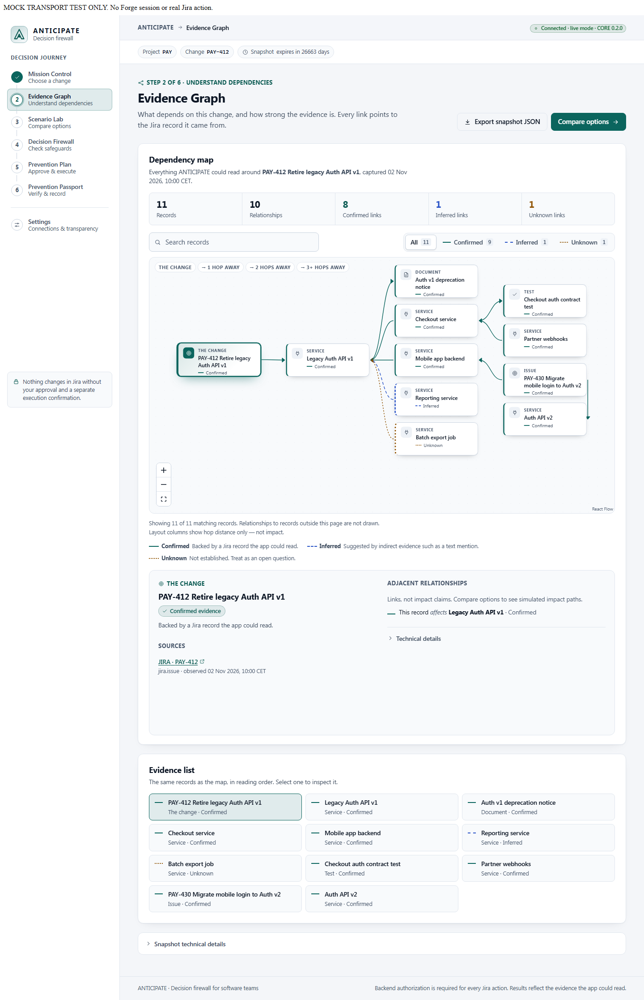

# ANTICIPATE

**Understand the dependencies before changing them. Approve preventive actions. Verify what actually happened.**

ANTICIPATE is a Forge application for Jira built for Codegeist 2026. It turns readable Jira evidence into a dependency graph, compares deterministic change scenarios, explains policy decisions and records approvals and verified execution outcomes in a Prevention Passport. Unknown evidence stays unknown; a recommendation is never an approval.

[Install in Jira — judge instructions](docs/submission/INSTALL_LINK.md) · [Current delivery status](docs/STATUS.md) · [CORE integration contract](docs/integration/CORE_CLIENT_INTEGRATION.md) · [Jury walkthrough](docs/jury/JURY_UI_SHOWCASE.md)

## A complete decision journey

1. **Mission Control:** choose an accessible project and the Jira issue describing the change; capture a snapshot.
2. **Evidence Graph:** inspect confirmed, inferred and unknown relationships, their sources and a keyboard-accessible list. Rendering uses bounded windows rather than an unreadable wall of nodes.
3. **Scenario Lab:** compare removal, temporary retention and migration first against the same snapshot.
4. **Decision Firewall:** understand blocking policies and unresolved questions. Administrator-configured Jira workflow enforcement is a separate optional capability.
5. **Prevention Plan:** select actions, explicitly approve them and separately confirm execution. The backend authorizes actions and verifies their results.
6. **Prevention Passport:** inspect evidence, alternatives, approvals, per-action outcomes and the decision timeline; export JSON or print.
7. **Settings:** distinguish manifest declarations, backend-reported availability and what has actually been verified.

If dependencies change after a plan was reviewed, approval/execution is refused. The UI displays the backend reason and reported added/removed relations or newly unknown evidence. It blocks the old plan and offers rebuilding the snapshot and reviewing a new comparison.

## Real browser captures

These are genuine Playwright screenshots of the connected UI running locally with **MOCK_TRANSPORT**, not design mockups or proof of hosted Jira execution. Their visible test banner identifies the provenance. CORE's separate hosted reports are in [the evidence pack](docs/evidence/EVIDENCE_PACK.md).

### Evidence Graph



### Scenario comparison


### Prevention Passport


[All seven screens, mobile views and error states](docs/design/UI_VISUAL_QA.md) · [Evidence-changed refusal capture](evidence/experience/v3-redesign/visual/30-executeApprovedPlan-MOCK.png) · [Sample preparation result capture](evidence/experience/v3-redesign/visual/31-sample-result-MOCK-390.png)

## Judges: prepare sample Jira data

After installing, open ANTICIPATE and choose an existing Jira project where you may create and link issues. In Mission Control, click **Prepare a demo project** (the English UI label for « Préparer un projet de démo »), then **Preview sample data**. Review the proposed labelled tickets and links before explicitly confirming **Create sample data**. Use **Analyze <issue key>** to begin the journey.

Opening or previewing does not write Jira. Confirmation creates real labelled sample issues in the selected project; it does not create a Jira project. Existing sample entries are reused, and no automatic cleanup is performed. If no project is accessible, create one in Jira or ask an administrator for access.

Sample creation may take 15–20 seconds according to CORE's hosted report. The client allows **60 seconds** for this operation. If the response still times out, creation may continue: click **Preview sample data** again to inspect existing results before any further creation. The UI never automatically resubmits the write or assumes success from a timeout.

## Develop locally on Windows

Use the existing checkout; do not register another Forge app. The GitHub workflow uses Node 22; the frontend requires the Node version supported by the pinned Vite release (see package metadata).

```powershell
Set-Location -LiteralPath 'C:\Users\Orpheane\Desktop\PROJECT-ANTIGRAVITY\ANTICIPATE'
npm ci
Set-Location -LiteralPath 'static\hello-world'
npm ci
npm start -- --host 127.0.0.1
```

Open `http://127.0.0.1:3000` for the isolated development fixture prototype. It performs no Atlassian writes and does not demonstrate the connected hosted journey. In a Forge iframe, the app loads `ForgeApp` → `CoreWorkspace` with the real Forge client and shared contracts; there is no production fixture fallback. A standalone production preview cannot supply an authenticated Forge bridge.

[Frontend guide and architecture](docs/README.md) · [Build/test evidence and limitations](docs/design/UI_RELEASE_READINESS.md)

## Checks

From `static/hello-world`:

```powershell
npm run typecheck
npm run lint
npm run format:check
npm test
npm run build
npx playwright install chromium
npx playwright test --workers=1
```

From the repository root: `npm run typecheck`, `npm test`, `npx vitest run --root packages/contracts` and `npx vitest run --root packages/simulation-core`.

The sample-timeout follow-up passed 49 frontend unit tests; the full UI v3 baseline passed 72 Chromium tests. Exact final results, engine scope and retry history are recorded in the release report and PR. CI runs CORE checks and the frontend install/build; local browser/axe checks are separate evidence.

## Ownership and limits

EXPERIENCE owns the frontend and its documentation. CORE owns the backend, shared contracts, manifest, Forge identity, deployment and authenticated hosted acceptance. This branch does not register/deploy apps or merge pull requests.

CORE's newer upgrade operation and read-only MCP tool are available through the backend/Rovo integration; the frontend scenario picker currently presents the retirement journey. Teamwork Graph availability depends on backend capabilities and external enablement. Local tests do not prove live permissions, Jira mutations, host sizing/themes or production readiness. Native screen-reader/zoom testing and long stability soaks remain outstanding; dependency and license findings are documented in the release report.

For public support, publisher and privacy details, use the [installation information](docs/submission/INSTALL_LINK.md) and CORE-maintained [privacy policy](docs/legal/PRIVACY.md) and [terms](docs/legal/TERMS.md).
