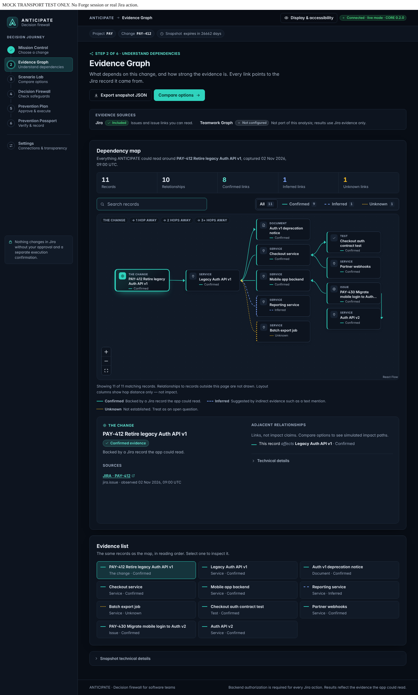
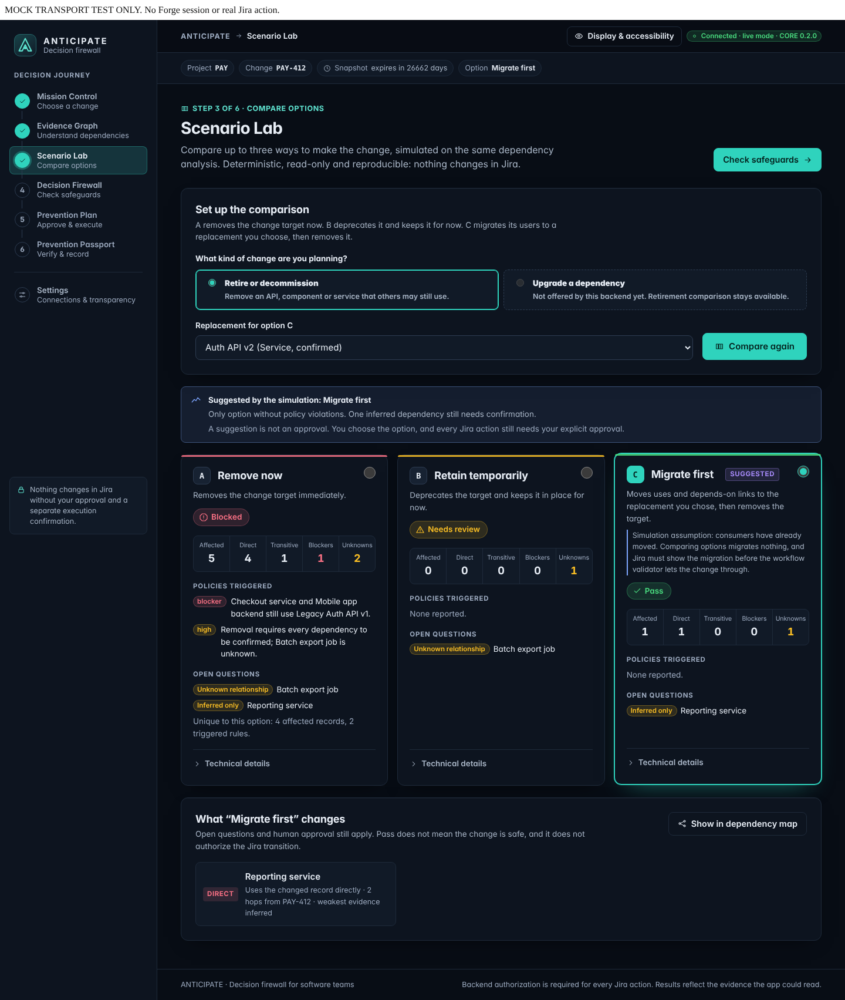
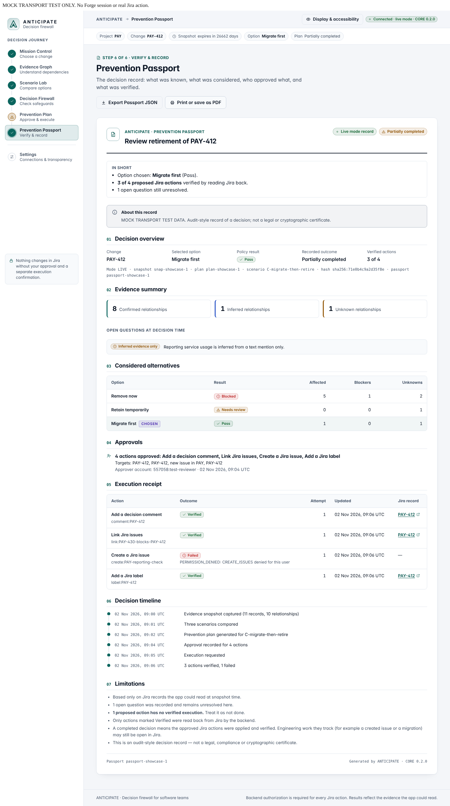

# ANTICIPATE — The Decision Firewall for Software Teams

**Test the consequences. Prove the safeguards. Then ship.**

ANTICIPATE is a Forge app for Jira, built for Atlassian Codegeist 2026 (Apps for Software Teams). Before a team retires an API, decommissions a service or ships a breaking upgrade, it shows what depends on the change, compares safer alternatives, explains why a risky option is blocked, and records the human decision with verified results.

[Install in Jira (judges)](docs/submission/INSTALL_LINK.md) · [Jury walkthrough](docs/jury/JURY_UI_SHOWCASE.md) · [Hosted evidence](docs/evidence/EVIDENCE_PACK.md) · [Status](docs/STATUS.md)

## The problem

A change ticket says "retire Auth API v1". It looks safe. The services that break are two links away, behind an issue nobody opened, or mentioned only in a comment. Teams usually find out in production, and afterwards nobody can show what was known when the decision was made.

## What ANTICIPATE does

1. **Reads the real dependencies.** It builds an evidence graph from the Jira issues and links you can access. Every relation is *Confirmed*, *Inferred* or *Unknown*, with the Jira record it came from. Unreadable evidence stays Unknown, never "safe".
2. **Compares alternatives, not just tickets.** The same evidence is simulated under several options: remove now, retain temporarily, migrate consumers first, or, for upgrades, breaking upgrade, backward-compatible shim, move consumers first. Results are deterministic and reproducible; there are no invented risk percentages.
3. **Explains the decision.** Policies say why an option is blocked or needs review, following the path from the change to the affected dependency.
4. **Keeps people accountable.** A prevention plan lists concrete Jira actions. A person approves them, then confirms execution as a separate step. The backend re-reads Jira to verify each result.
5. **Refuses stale decisions.** If the dependencies change after approval, execution is refused and the screen shows exactly what changed.
6. **Guards the Jira transition (optional).** A workflow validator stops issues labelled `anticipate-change` until their decision is completed and the live Jira links agree. A simulated "migrate first" never opens the gate by itself. Administrators choose whether transitions pass or are blocked when ANTICIPATE is unavailable.
7. **Records the proof.** The Prevention Passport starts with a short answer (option, verified actions, transition status, open questions) and keeps the evidence, alternatives, approvals, verified outcomes and timeline, as JSON or a printable A4 report. It is an audit-style record, not a legal or cryptographic certificate.

## Screens

These are real Playwright captures of the connected UI with a **mock backend transport (MOCK_TRANSPORT)**, labelled on screen. They are not hosted Jira results; hosted results are listed in the [evidence pack](docs/evidence/EVIDENCE_PACK.md).

| Evidence Graph | Scenario Lab | Prevention Passport |
| --- | --- | --- |
|  |  |  |

What the graph adds on the sample data: [direct Jira links vs ANTICIPATE](docs/jury/VALUE_BENCHMARK.md). More: [all screens, mobile and error states](docs/design/UI_VISUAL_QA.md) · [dependency upgrade comparison](evidence/experience/v4-ux/scenario-lab-upgrade-light-1440-MOCK_TRANSPORT.png) · [printed Passport (PDF)](evidence/experience/v4-ux/passport-long-print-MOCK_TRANSPORT.pdf).

## Try it in Jira (about one minute once sample data exists)

1. Install with the [judge link](docs/submission/INSTALL_LINK.md) and open ANTICIPATE from Jira.
2. Click **Start the guided demo**, choose a company-managed project where you can browse, create and link issues.
3. **Preview sample data** (read-only), then confirm **Create sample data**: six labelled issues and four links. First-time creation takes about 15–20 seconds; if the screen waits longer, ANTICIPATE re-reads Jira instead of retrying the write.
4. **Analyze** the sample root → **Compare options** → **Check safeguards** → **Generate prevention plan** → approve, then execute → **Prevention Passport**.

Opening or previewing never writes to Jira. No Jira project is created and nothing is deleted automatically. With no accessible project, the app says which permissions are needed.

## Architecture

- **Forge Custom UI** (React, TypeScript) in a Jira global full page, with the Atlassian host theme, a dark default and a Display & accessibility menu.
- **Forge resolvers** (Node) call Jira REST as the user, so Jira permissions apply. Forge storage keeps plans, approvals and execution leases.
- **Pure TypeScript simulation and policy engine**, shared **zod contracts** validated on both sides.
- **Jira workflow validator** (optional, admin-configured): issues labelled `anticipate-change` cannot move forward until their decision is completed; an admin setting in Settings decides what happens during an outage (Allow by default, or Block).

### Rovo and MCP

A Rovo agent, *ANTICIPATE Decision Reviewer*, and five read-only MCP tools (evidence graph, simulate retirement, simulate upgrade, Passport, plan freshness) answer "what happens if we change X?" using the same engine. They never approve or execute. Availability depends on the site's Rovo access and an administrator toggle for MCP.

**Teamwork Graph:** not integrated. It is a Forge Preview capability that needs graph read scopes and access checks; CORE has a prototype adapter that is not wired. The app shows it as *Not configured* and uses Jira evidence only.

## Safety by design

- Approval and execution are separate, explicit steps, and the backend authorizes every action.
- Execution is idempotent and leased; lost responses are recovered by plan ID, never blindly retried.
- A suggested option is never an approval. Timeouts are not treated as success or failure: the app re-reads Jira.
- Display only what the backend reports: declared capabilities are not shown as verified.

## Tests and evidence

From `static/hello-world`:

```bash
npm ci
npm run typecheck && npm run lint && npm run format:check
npm test
npm run build
npx playwright test
```

From the repository root: `npm ci`, `npm run typecheck`, `npm test`.

Latest local results (Chromium, mock transport): 60 frontend unit tests and 90 browser tests, including axe WCAG 2.2 AA checks on light and dark themes, 320 px reflow, keyboard paths, Passport A4 print and security refusals. Automated accessibility checks are not a WCAG certification. Firefox and WebKit runs are recorded per release in [UI release readiness](docs/design/UI_RELEASE_READINESS.md).

Hosted results (deployed Forge app on Jira Cloud) are recorded by CORE with date, site and procedure in the [evidence pack](docs/evidence/EVIDENCE_PACK.md), including verified writes, the evidence-changed refusal, the workflow validator, sample data and Rovo.

## Honest limitations

- Evidence comes from Jira issues, links and components only; unreadable items stay Unknown.
- Policies are deterministic rules, not predictions; ANTICIPATE does not claim to prevent every incident.
- Local browser tests use a mock transport; hosted behaviour is verified separately and is listed with its scope.
- Native screen-reader and browser-zoom testing are partial.

## Codegeist 2026

Category: Apps for Software Teams. Bonus candidates: Rovo agent and MCP tools. Built by two people: CORE (backend, engine, Forge, security) and EXPERIENCE (interface, accessibility, presentation).

Licence: proprietary, source available. Copyright © 2026 toskaman and Orphee; see [LICENSE](LICENSE). Support, privacy and terms: [installation information](docs/submission/INSTALL_LINK.md), [privacy](docs/legal/PRIVACY.md), [terms](docs/legal/TERMS.md).
