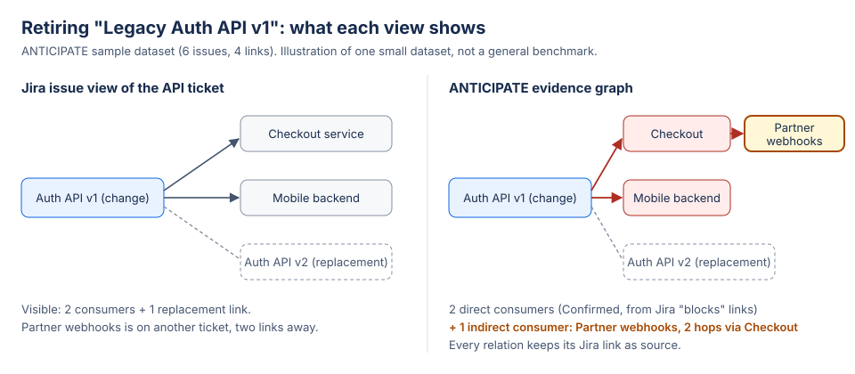

# What the graph adds: direct links vs ANTICIPATE (sample dataset)

Scope: the six-issue sample dataset that ANTICIPATE creates in the guided demo (`src/engine/sample.ts`). It is a small, explicitly described dataset, not a measurement of real companies, and must not be extrapolated.

## Dataset
| Issue | Role | Jira links |
|---|---|---|
| Legacy Auth API v1 | The change (retire it) | blocks Checkout, blocks Mobile backend, linked to Auth API v2 |
| Checkout service | Direct consumer | blocks Partner webhooks |
| Mobile backend | Direct consumer | — |
| Partner webhooks | Consumer of Checkout | — |
| Auth API v2 | Replacement | — |
| Checkout auth contract test | Test, not linked | — |

## Comparison
| Question | Jira issue view of the API ticket | ANTICIPATE |
|---|---|---|
| Direct consumers | 2 links visible (Checkout, Mobile backend), plus the link to v2 | 2 direct consumers, each with its Jira link as source |
| Indirect impact | Partner webhooks is not visible: it is two links away, on another ticket | 1 indirect consumer (Partner webhooks, 2 hops through Checkout), with the path |
| Unknowns | Not reported | Unreadable or ambiguous relations are listed as Unknown |
| Options compared | None | Remove now, retain temporarily, migrate first (an assumption), each with its verdict |
| Decision record | Comments, if someone writes them | Prevention Passport: evidence, options, approvals, verified actions, transition status |

Measured locally on this dataset: reaching the evidence graph from a fresh project takes 6 clicks (Start the guided demo, choose project, Preview, Create, Confirm, Analyze), plus about 15 to 20 s for first-time creation on the hosted site. The time for a juror to read the result is to be measured on recording day, not estimated here.

The synthetic precision/recall benchmark (`docs/evidence/BENCHMARK.md`, 200 generated graphs, P = R = 1 against an oracle) checks the engine against its own definition of impact. It is a synthetic correctness test, not a field accuracy figure.

